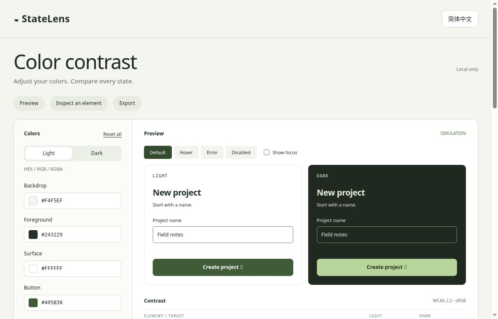

# StateLens 0.2

**English** · [简体中文](README.zh.md)

Compare colors across light, dark and component states. Adjust transparent colors, inspect captured text styles, and export CSS or JSON.

[Open demo](https://statelens-design-lab.fuzzy-boar-2990.chatgpt.site)



## What changed

- Explicit sRGB alpha colors: HEX / HEX alpha / `rgb()` / `rgba()`. Declare an opaque backdrop, then compose surface → fill → text without rounding before calculating WCAG 2 contrast.
- Error and focus can coexist. Actual keyboard focus updates the corresponding specimen’s focus-color row; the checkbox is a forced two-theme simulation.
- Disabled specimens retain their measured ratios and offer readability suggestions while remaining normatively **exempt**, not passing. The specimen uses 40% group opacity, modeled after composing its internal colors.
- Capture the computed styles of a selected text element in **your own page**, import its JSON locally, and retain original layers, source metadata and unsupported-effect warnings in a report. CSS variables resolve through the browser’s computed styles; this is not pixel sampling.
- A small versioned snapshot contract, tested shared engine, CLI and example GitHub Actions workflow. CI only checks saved color evidence; it does not navigate or certify the current page.
- Chinese/English interface. APCA is **not bundled**: use the [official research tool](https://www.myndex.com/APCA/) with copied resolved opaque colors and its font guidance. Lc is not a WCAG 2 compliance result. Its separate license is not represented as MIT.

## Run and test

Use Node 20+ for tests and the CLI. Runtime UI has no third-party dependencies; jsdom is a **development test dependency**, not a browser bundle.

```sh
npm ci
npm test
node tools/check-snapshot.cjs examples/snapshot.json
python3 -m http.server 8000 --directory dist
```

Open the served page. The UI can also open directly from disk, but fetching the collector source may require HTTP; its visible source link remains available. Token edits and snapshots stay in tab memory, and refresh resets them. Export before leaving.

## Capture an actual text element

1. In your own page’s DevTools select a **leaf text element** as `$0`. Manually enter each state you want to inspect; capture does not click, focus, or force a state.
2. Review and paste [dist/capture.js](dist/capture.js). Do not blindly paste unknown scripts.
3. Provide the real opaque canvas color and visually confirm no overlapping content obscures the element:

```js
copy(JSON.stringify(StateLensCapture($0, {
  backdrop: '#FFFFFF',
  confirmUnobscured: true
}), null, 2))
```

4. Review the JSON, paste it into StateLens and analyze locally. The collector does not read text content, URLs, hrefs or selectors, and performs no network request. Imported JSON is data, never executable code.

Unknown backgrounds, gradients/images, shadows, masks, blend modes, group opacity, complex clipping, generated content and unsupported painting geometry yield **unsupported**, not a pass. Overlap absence is a user declaration, not proven by the collector. Borders, icons, focus-ring geometry, screen-reader semantics and state coverage are not snapshot-audited. Capture is conservative and may require manual review even when a visual result looks simple.

## CLI and CI boundary

```sh
node tools/check-snapshot.cjs my-snapshot.json > report.json
```

- `0`: every eligible captured text pair passes; disabled advisories are not conformance failures.
- `1`: at least one supported, non-exempt text pair fails.
- `2`: malformed input or any unsupported/incomplete pair. Do not treat it as a pass.

The GitHub Actions workflow installs dependencies and runs the automated tests. Add your own **freshly captured** snapshots only after deciding how your project records page versions and states. A stale passing snapshot does not validate today’s UI.

## Formats and migration

Snapshot `schemaVersion: 1` is distinct from the token export `schemaVersion: 2`. Token exports carry both theme palettes, an opaque backdrop per theme and assumptions. v0.1 exported palettes can be retained as reference; there is no automatic palette-import/migration UI in this version. Do not paste token exports into the snapshot importer. Never imply that the added backdrop can be inferred from old palettes.

## Scope and standards

WCAG 2 sRGB relative luminance; text targets 4.5:1, or 3:1 for at least 24 CSS px / 18.6667 CSS px at weight ≥700. Selected non-text lab rows use 3:1 as a color reference, not a complete criterion. Full-precision numbers determine results; display HEX and ratios are rounded.

- [Contrast minimum](https://www.w3.org/WAI/WCAG22/Understanding/contrast-minimum.html)
- [Non-text contrast](https://www.w3.org/WAI/WCAG22/Understanding/non-text-contrast.html)
- [APCA research](https://git.apcacontrast.com/)

## Validation

21 automated tests passed. Desktop browser checks covered keyboard focus, language switching, snapshot statuses, copying JSON/CSS and report download. See [QA.md](QA.md) for scope and remaining gaps.

## License

[MIT](LICENSE) for this repository’s code, © 2026 Liyan Chen. No APCA implementation is redistributed.
