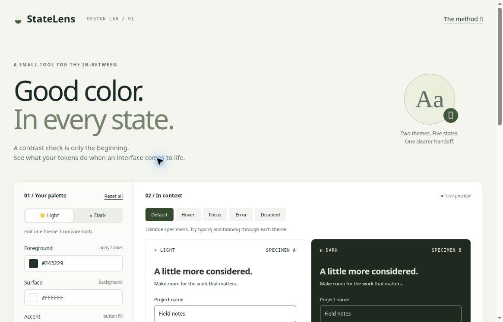
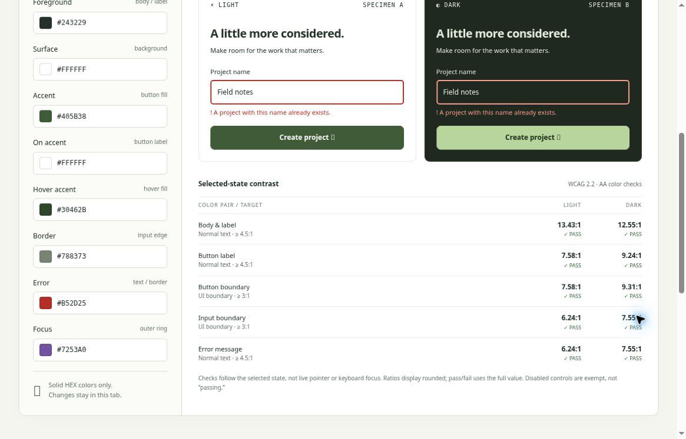

# StateLens · UI 状态对比度工作台

[English](README.md) · **简体中文**

一个原创、零依赖的小型设计工具。作者：Liyan Chen。版本：0.1.0。

[**在线体验 Demo**](https://statelens-design-lab.fuzzy-boar-2990.chatgpt.site) · [English guide](README.md)



## 它解决什么
不是再做一个只比较两个色块的检查器，而是将语义颜色、明暗主题、交互状态和交付代码放在一起。差异化是待验证的工作流假设，不宣称首创，也不替代 Stark 等成熟产品。

## 核心功能
- 分别编辑明暗主题的 8 个语义 HEX 颜色。
- 在可编辑组件中比较默认、悬停、焦点、错误和禁用状态。
- 查看文字、控件边界和状态指示的对比度；禁用项明确标为豁免。
- 复制或下载包含两套主题的 CSS / JSON。



*以上为真实桌面浏览器截图，不是移动端截图或生成效果图。*

## 开始使用
直接打开 dist/index.html（无需安装），或在 dist 目录运行 python3 -m http.server 8000，再访问 localhost:8000。所有编辑在当前标签页内存中进行，不上传输入、不使用分析服务；刷新会重置，请先导出。

1. 在左侧切换 Light / Dark，编辑 #RGB 或 #RRGGBB。无效输入显示提示，预览与导出保留上一次有效值。
2. 两个主题并排预览。输入框可编辑，按钮只演示交互，不提交数据。
3. 切换 Default、Hover、Focus、Error、Disabled。Hover / Focus 是强制样式；真实鼠标与键盘交互也有效。Error 只作用于输入框、边框和错误文本；Disabled 只禁用输入框和按钮。
4. 查看每个颜色配对的实际比率。结果用未舍入值判定，显示值保留两位。
5. CSS 导出包含两套变量和 .sl-card、.sl-input、.sl-button、.sl-error 状态样式；JSON 导出包含两套颜色与阈值。支持复制与下载。复制受浏览器权限限制时自动选中代码供手动复制。

## 复用示例
引入导出的 statelens-tokens.css，使用：

```html
<section class="sl-card" data-theme="light">
  <label for="name">项目名称</label>
  <input id="name" class="sl-input" aria-describedby="error">
  <p id="error" class="sl-error"></p>
  <button class="sl-button">创建项目</button>
</section>
```

深色容器改为 data-theme="dark"。出错时给 input 添加 aria-invalid="true"，填写错误信息；禁用时使用原生 disabled。交付样式不负责业务校验和表单提交。

## 判定范围与限制
- sRGB 相对亮度与 WCAG 对比度公式，仅支持不透明纯 HEX 颜色。
- 普通文本 AA ≥ 4.5:1，大文本 ≥ 3:1；大文本至少 24px 常规或约 18.7px 粗体。本工具样本文本按普通文本检查。
- 必要的 UI 边界及状态标记通常需要与相邻颜色 ≥ 3:1；本样本计算边框/按钮/外侧焦点环与其外侧 surface 的配对。
- 禁用控件属于对比度豁免，不标成通过；容器正文仍检查。
- 焦点环颜色通过不代表焦点可见性、面积、遮挡或整个组件符合 WCAG。真实布局、透明度、图像、文字大小、键盘路径、语义及错误恢复仍需人工检查。
- 不自动修复颜色，避免用单个“无障碍评分”掩盖实际语境。

## 检查
node tests/contrast.test.cjs
node --check dist/app.js

详见 QA.md。浏览器检查范围、不能验证的部分均记录，不用静态检查冒充完整交互验收。

## 文件
- dist/：完整零依赖应用
- tests/：对比度纯函数测试
- QA.md：实际验收范围
- LICENSE：原创代码 MIT 许可

在线 Demo：https://statelens-design-lab.fuzzy-boar-2990.chatgpt.site

## 参考标准
https://www.w3.org/WAI/WCAG22/Understanding/contrast-minimum.html
https://www.w3.org/WAI/WCAG22/Understanding/non-text-contrast.html
https://www.w3.org/WAI/WCAG22/Understanding/focus-visible.html

## 许可

[MIT 许可证](LICENSE) · Copyright © 2026 Liyan Chen。
