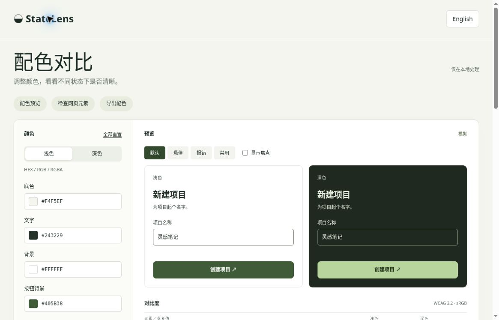

# StateLens 0.2

[English](README.md) · **简体中文**

对比浅色、深色和不同组件状态下的配色。调整透明色、检查采集的文字样式，再导出 CSS 或 JSON。

[打开演示](https://statelens-design-lab.fuzzy-boar-2990.chatgpt.site)



## 本次实际改动

- 支持显式 sRGB 透明色：HEX／透明 HEX／`rgb()`／`rgba()`。指定不透明底色后，按表面 → 填充 → 文字合成，计算前不取整。
- 错误态可以叠加焦点。真实键盘聚焦会同步对应主题的焦点颜色行；复选框用于强制模拟两个主题。
- 禁用示例仍显示实际比率和可读性改良建议，但规范状态始终为**豁免**而不是通过。示例先合成内部颜色，再模拟 40% 组透明度。
- 在自己的真实页面中捕获一个选中文字元素的计算样式，导入本地 JSON；报告保留原始图层、来源信息和不支持效果。CSS 变量由浏览器计算样式解析，不是像素采样。
- 加入版本化快照契约、共享计算核心、CLI、测试和示例 GitHub Actions。CI 只检查保存的颜色证据，不浏览或认证当前页面。
- 中英文界面。本版**未内置 APCA**：可将合成后的不透明颜色复制到[官方研究工具](https://www.myndex.com/APCA/)，结合字体指导解读。Lc 不代表 WCAG 2 合规，也不把 APCA 的独立许可冒称为 MIT。

## 运行与测试

测试及 CLI 使用 Node 20+。网页运行时无第三方依赖；jsdom 是**开发测试依赖**，不打入浏览器包。

```sh
npm ci
npm test
node tools/check-snapshot.cjs examples/snapshot.json
python3 -m http.server 8000 --directory dist
```

打开服务地址即可。直接打开文件也可使用界面，但读取采集器源码可能需要 HTTP；可手动打开源码链接。配色和快照仅存于当前标签页，刷新重置，请先导出。

## 从真实文字元素捕获

1. 在自己的页面中通过开发者工具选择**叶级文字元素** `$0`。先手动进入想检查的状态；采集器不点击、不聚焦、不强制状态。
2. 审阅后粘贴 [dist/capture.js](dist/capture.js)，不要盲目粘贴陌生脚本。
3. 填写真实的不透明画布底色，目视确认没有覆盖内容后执行：

```js
copy(JSON.stringify(StateLensCapture($0, {
  backdrop: '#FFFFFF',
  confirmUnobscured: true
}), null, 2))
```

4. 检查 JSON，再粘贴到 StateLens 本地分析。采集器不读取页面文字、网址、href 或选择器，不发送网络请求。导入 JSON 只作为数据，绝不执行其中代码。

未知背景、渐变／图片、阴影、遮罩、混合、组透明度、复杂裁切、生成内容及不支持的绘制几何会标为**无法判断**，不是通过。“无覆盖”来自用户声明，并非采集器证明。边框、图标、焦点环几何、读屏语义和状态覆盖不在快照检查范围内。采集策略刻意保守，即使视觉上简单也可能要求人工检查。

## CLI 与 CI 的真实边界

```sh
node tools/check-snapshot.cjs my-snapshot.json > report.json
```

- `0`：所有可判断、非豁免文字颜色对通过；禁用态建议不是规范失败。
- `1`：至少一个支持的非豁免文字颜色对未达目标。
- `2`：输入无效，或有不支持／不完整项；不能算通过。

附带 Actions 安装依赖并运行自动化测试。项目应先决定如何记录页面版本与状态，再纳入自己**重新捕获**的快照。过期快照通过，不代表今天的 UI 通过。

## 格式与迁移

快照 `schemaVersion: 1` 与配色导出 `schemaVersion: 2` 是不同格式。配色导出保留两个主题、每主题显式不透明底色及假设。v0.1 配色可留作参考，但本版没有自动配色导入／迁移界面。不要将配色导出粘贴到快照导入区，也不能从旧配色推断真实底色。

## 计算与范围

采用 WCAG 2 sRGB 相对亮度。普通文字 4.5:1；字号至少 24 CSS px，或至少 18.6667 CSS px 且字重 ≥700 时为 3:1。实验区非文字行的 3:1 是颜色参考，不代表完整条款。使用完整精度判断，显示 HEX 与比率才取整。

- [WCAG 文字对比](https://www.w3.org/WAI/WCAG22/Understanding/contrast-minimum.html)
- [非文字对比](https://www.w3.org/WAI/WCAG22/Understanding/non-text-contrast.html)
- [APCA 研究](https://git.apcacontrast.com/)

## 验证

22 项自动化测试通过。真实桌面浏览器已检查键盘焦点、中英切换、导入结果状态、JSON/CSS 复制与报告下载。具体范围和未验证项目见 [QA.md](QA.md)。

## 许可

本仓库自身代码为 [MIT](LICENSE)，© 2026 Liyan Chen。不重新分发 APCA 实现。
